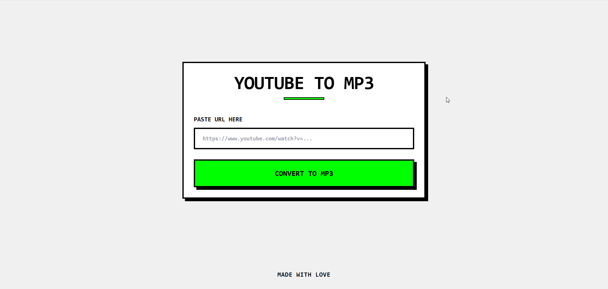

# YouTube to MP3 Converter

A full-stack web application that converts YouTube videos to MP3 format using Node.js/Express backend and a Neo-Brutalist design frontend built with Tailwind CSS.



## Features

- Convert YouTube videos to MP3 format with high-quality audio extraction
- Neo-Brutalist UI design with bold typography and high contrast colors
- Real-time conversion with visual progress indication
- Rate limiting to prevent server IP flagging
- Efficient streaming architecture (no disk storage required)
- Comprehensive error handling and validation
- Fully responsive design for mobile and desktop

## Prerequisites

Before running this application, ensure you have the following installed:

### Required Software

1. **Node.js** (v14 or higher) - [Download](https://nodejs.org/)
2. **yt-dlp** - YouTube video downloader binary
3. **FFmpeg** - Audio/video processing tool

### Installing yt-dlp

#### Windows
```powershell
winget install yt-dlp
```

Or download manually from [yt-dlp releases](https://github.com/yt-dlp/yt-dlp/releases/latest) and add to PATH.

#### macOS
```bash
brew install yt-dlp
```

#### Linux (Ubuntu/Debian)
```bash
sudo apt update
sudo apt install yt-dlp
```

### Installing FFmpeg

#### Windows
1. Download from [ffmpeg.org](https://ffmpeg.org/download.html)
2. Extract and add the `bin` folder to system PATH
3. Verify: `ffmpeg -version`

#### macOS
```bash
brew install ffmpeg
```

#### Linux (Ubuntu/Debian)
```bash
sudo apt update
sudo apt install ffmpeg
```

## Installation

1. **Clone the repository:**
```bash
git clone <repository-url>
cd ytdl
```

2. **Install dependencies:**
```bash
npm install
```

3. **Configure FFmpeg path (Windows only):**
   
   Edit `server.js` line 9 to point to your FFmpeg installation:
   ```javascript
   ffmpeg.setFfmpegPath('C:\\ffmpeg\\bin\\ffmpeg.exe');
   ```

## Running the Application

**Start the server:**
```bash
npm start
```

**Development mode with auto-restart:**
```bash
npm run dev
```

**Access the application:**
```
http://localhost:3000
```

## Docker

```bash
docker compose up -d --build
```

The app listens on `127.0.0.1:3000` and is served under `BASE_PATH` (`/yt-to-mp3`; leave it empty to serve from the root). Put a reverse proxy in front of it, for example nginx:

```nginx
location = /yt-to-mp3 { return 301 /yt-to-mp3/; }
location /yt-to-mp3/ {
    proxy_pass http://127.0.0.1:3000;
    proxy_set_header Host $host;
    proxy_set_header X-Forwarded-For $proxy_add_x_forwarded_for;
    proxy_read_timeout 300s;
    proxy_buffering off;
}
```

`TRUST_PROXY` (default `2` in `docker-compose.yml`) sets how many reverse proxies sit in front of the app, so rate limiting reads the real client IP.

## Usage

1. Open the application in your web browser
2. Paste a valid YouTube URL into the input field
3. Click the "CONVERT TO MP3" button
4. Wait for the conversion process to complete
5. Click "DOWNLOAD MP3" to save the audio file

## Project Structure

```
ytdl/
├── public/
│   ├── index.html      # Neo-Brutalist frontend UI
│   └── app.js          # Client-side JavaScript logic
├── server.js           # Express backend server
├── package.json        # Project dependencies
├── .gitignore          # Git ignore rules
└── README.md           # Documentation
```

## Technical Stack

### Backend
- **Express** - Web server framework
- **youtube-dl-exec** - YouTube video/audio downloader wrapper
- **fluent-ffmpeg** - Audio transcoding and processing
- **express-rate-limit** - Request rate limiting middleware
- **CORS** - Cross-origin resource sharing support

### Frontend
- **Tailwind CSS** - Utility-first CSS framework
- **Vanilla JavaScript** - No framework dependencies
- **Neo-Brutalist Design** - Bold, high-contrast aesthetic with hard shadows

### Architecture Highlights
- Direct streaming to client (zero disk storage)
- URL validation before processing
- Graceful error handling without server crashes
- Proper Content-Disposition headers for file downloads
- IP-based rate limiting to prevent abuse

## Configuration

### Rate Limiting
The application enforces rate limits to protect server resources:
- **Limit:** 10 conversions per 15 minutes per IP address
- **Purpose:** Prevents excessive requests and potential IP flagging

### Audio Quality
- **Format:** MP3
- **Quality:** Best available audio stream
- **Bitrate:** Optimized for balance between quality and file size

## Error Handling

The application handles the following error scenarios:

| Error Type | Description | Resolution |
|------------|-------------|------------|
| Invalid URL | Non-YouTube URL provided | Enter a valid YouTube URL |
| Conversion Failed | Processing error during conversion | Retry or check video availability |
| Rate Limit Exceeded | Too many requests from IP | Wait 15 minutes before retrying |
| Network Error | Connection issues | Check internet connection |

## Troubleshooting

### yt-dlp not found
**Error:** `Command failed: yt-dlp`  
**Solution:** Install yt-dlp and ensure it's accessible in system PATH

### FFmpeg not found
**Error:** `Cannot find ffmpeg`  
**Solution:** Install FFmpeg and configure the path in `server.js`

### Port already in use
**Error:** `EADDRINUSE: address already in use :::3000`  
**Solution:** Change PORT in `server.js` or terminate the process using port 3000

### 403 Forbidden errors
**Error:** `Status code: 403`  
**Solution:** This is handled by youtube-dl-exec which bypasses YouTube's bot protection

## Development

To contribute or modify the application:

1. Fork the repository
2. Create a feature branch
3. Make your changes
4. Test thoroughly
5. Submit a pull request

## Security Considerations

- Rate limiting prevents abuse and protects server resources
- No user data is stored or logged
- All conversions are processed in-memory
- CORS is enabled for local development only

## License

ISC

## Disclaimer

This application is intended for educational purposes only. Users are responsible for ensuring they have the right to download and convert content. Please respect YouTube's Terms of Service and copyright laws in your jurisdiction.

## Acknowledgments

Built with modern web technologies and designed with a Neo-Brutalist aesthetic for a bold, uncompromising user experience.
